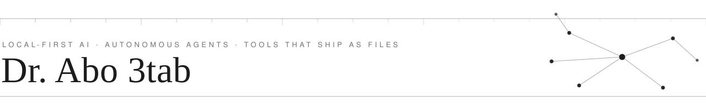

<picture>
  <source media="(prefers-color-scheme: dark)" srcset="assets/banner-dark.svg">
  
</picture>

I build AI systems that run on your own machine and hand back something you own — a file, an HTML page, a deck, a folder of evidence. No account, no backend, no subscription standing between you and the work.

**Now:** JARVIS — a local AI that actually operates your computer — and Swarmcraft, nine cursors that draw a website and hand you the HTML.

<picture>
  <source media="(prefers-color-scheme: dark)" srcset="assets/loop-dark.svg">
  
</picture>

**Selected work**

| | Project | What it does |
| :--: | :-- | :-- |
|  | **[JARVIS](https://github.com/mafk21/jarvis)** [documentation](https://jarvis-khaki-eight.vercel.app/docs/) | A local-first AI system that can see, speak, remember, and act — voice, screen vision, computer control, durable memory, long-running work. Windows · macOS · Linux. |
|  | **[Swarmcraft](https://github.com/mafk21/swarmcraft)** | Describe a website and nine AI cursors draw it in front of you. Your own Gemini key, no backend, no model-written CSS. You keep the HTML. |
|  | **[OSINT Monster](https://github.com/mafk21/OSINT)** | Autonomous recon engine: 45+ passive collectors, fully offline forensic decoders, graph studio, and a validated 760-tool arsenal. Zero pip dependencies. |
|  | **[NEXUS](https://github.com/mafk21/NEXUS)** | A desktop that reshapes itself per task — categories → setups → activation, each with its own wallpaper, accent, and shortcuts. Electron. |
|  | **[Connect Everything](https://github.com/mafk21/connect-everything)** [live site](https://connect-everything-tau.vercel.app) | 534 hand-curated resources across 504 domains with 64 controlled tags. No accounts, no tracking, no ads — every card is one click out. |
|  | **[PowerPoint Skill](https://github.com/mafk21/PowerPoint-skill)** | An AI skill for decks built on real research — Morph transitions, 13 layout blueprints, an Arabic/RTL path, and a 238-record queryable database. |

**How I build**

- **Local-first by default.** Your keys, your machine, your files. If it needs a server, it has to earn it.
- **The output is a file.** HTML you can open, a `.pptx` you can edit, evidence you can keep — not data locked inside someone's dashboard.
- **Say the limits out loud.** Unverified installers, missing demos, and known trade-offs are written in the README rather than discovered by you later.
- **Fewer, better parts.** Zero pip dependencies where possible, and one clear path to run the thing.

**Toolbox**

`Python` · `TypeScript` · `JavaScript` · `Astro` · `Node` · `Electron` · `Playwright` · `SQLite / FTS5` · `MCP` · `GitHub Actions`

**[guns.lol/dr.abo3tab](https://guns.lol/dr.abo3tab)** · [Email](mailto:mbm143105@gmail.com) · [All repositories](https://github.com/mafk21?tab=repositories)
